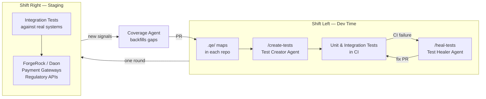
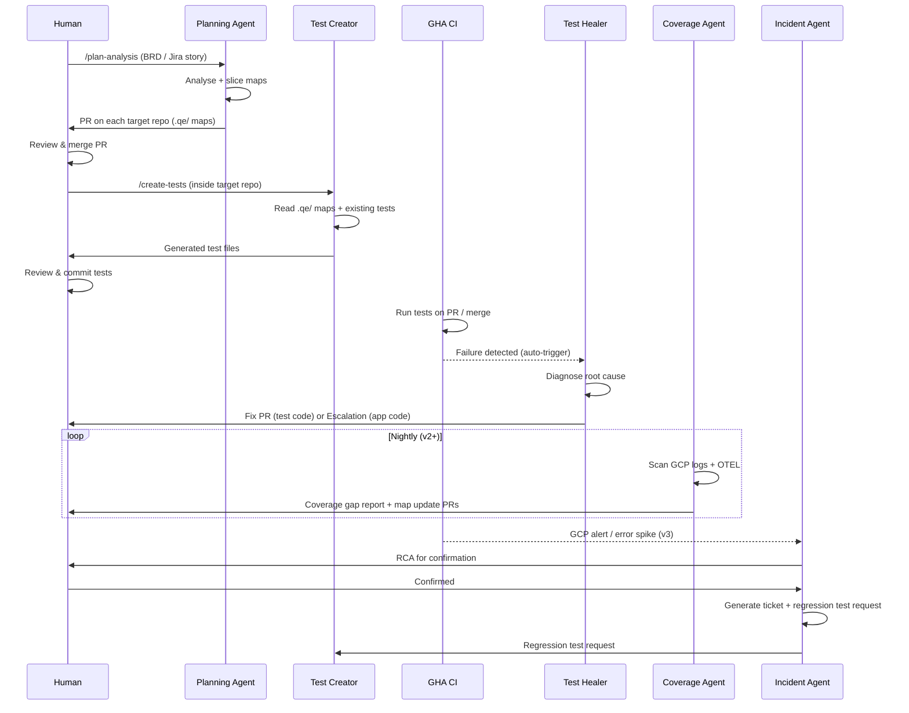
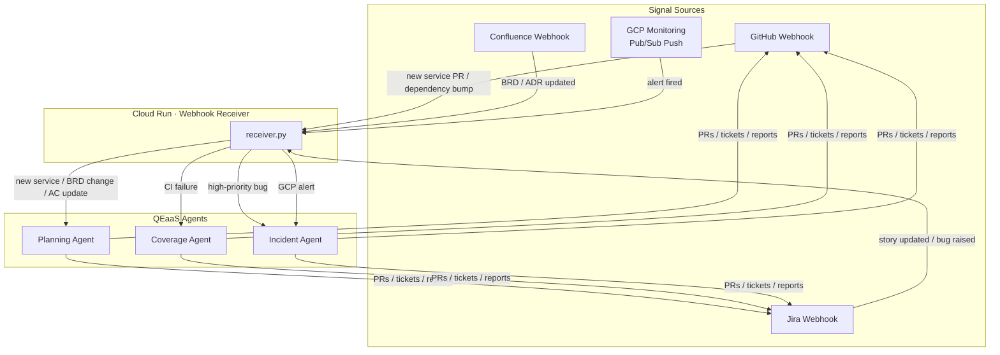

# QEaaS — Quality Engineering as a Service

A multi-agent QE framework for finance-sector systems. Operates across the full software lifecycle — from requirements analysis through production incident response — with finance-specific constraints baked in at every layer.

---

## Architecture

### Full System Overview


---

### Shift-Left / Shift-Right Model



---

### Agent Interaction & Data Flow



---

### v3 Webhook-Driven Automation



---

## Versions

| Version | What's included | Trigger mode |
|---|---|---|
| **v1** | Planning Agent, Test Creator Agent, Test Healer Agent | Manual slash commands |
| **v2** | + Coverage Agent, Incident Agent, auto-heal on CI failure, nightly scan | Manual + scheduled GHA |
| **v3** | + Webhook receiver on Cloud Run — fully event-driven | Fully automated |

---

## Agent Reference

### In `qe-as-a-service` (Strategic Layer)

| Agent | Command | Trigger | Output |
|---|---|---|---|
| Planning & Analysis | `/plan-analysis` | BRD, Jira story, arch diagram | Sliced `.qe/` maps via PR on each target repo |
| Coverage & Gap | `/coverage-gap` | Manual or nightly at 03:00 UTC | Gap report, map update PRs, test creation requests |
| Incident Analysis | `/incident-rca` | Manual or GCP alert (v3) | Confirmed RCA, Jira ticket, regression test request |

### In Each Target Repo (Shift Left)

| Agent | Command | Trigger | Output |
|---|---|---|---|
| Test Creator | `/create-tests` | Manual after `.qe/` maps merged | pytest / Go test files in existing test dirs |
| Test Healer | `/heal-tests` | Manual or auto on CI failure (v2+) | Fix PR or escalation |

---

## Repo Structure

```
qe-as-a-service/
├── CLAUDE.md                          # Master orchestrator prompt
├── .mcp.json                          # MCP server stubs (add credentials)
├── .claude/
│   ├── agents/
│   │   ├── planning-agent.md          # Slices maps, raises PRs
│   │   ├── coverage-agent.md          # GCP/OTEL gap analysis (v2)
│   │   └── incident-agent.md          # RCA + regression requests (v2)
│   └── commands/
│       ├── plan-analysis.md           # /plan-analysis
│       ├── coverage-gap.md            # /coverage-gap (v2)
│       └── incident-rca.md            # /incident-rca (v2)
├── .github/workflows/
│   └── nightly-coverage-scan.yml      # Scheduled coverage scan (v2)
├── artifacts/                         # Cross-cutting outputs
│   ├── test-strategy-template.md
│   └── infra-map-template.md
├── repo-templates/                    # PR'd into target repos on setup
│   ├── identity-repo/
│   │   ├── .qe/                       # Identity-scoped maps
│   │   ├── .claude/agents/            # pytest test-creator + healer
│   │   └── .github/workflows/         # Auto-heal (CI failure) +
│   │                                  # qe-create-tests-dispatched (v2 cross-repo)
│   └── microservices-repo/
│       ├── .qe/                       # Transaction-scoped maps
│       ├── .claude/agents/            # Go test-creator + healer
│       └── .github/workflows/         # Auto-heal + qe-create-tests-dispatched
├── target-repos/
│   ├── identity-repo.json             # ForgeRock/Daon repo config
│   └── microservices-repo.json        # Golang microservices config
├── webhooks/
│   └── receiver.py                    # Flask webhook receiver (v3)
└── deploy/cloud-run/                  # Cloud Run deployment (v3)
    ├── Dockerfile
    ├── service.yaml
    └── deploy.sh
```

---

## Example Usecase Constraints

Applied by every agent, baked into every agent prompt:

| Constraint | Rule |
|---|---|
| Monetary values | `Decimal` always — never `float` or `float64` |
| PII fields | Synthetic/masked data only — never real customer data |
| Regulatory fields | Format, presence, and value validated at every layer |
| Audit trail | Completeness verified wherever applicable |
| KYC/AML flows | First-class test scenarios, not edge cases |
| Fraud signals | Velocity checks and pattern simulation in scope |
| Boundary conditions | Null, empty, min, max, zero, negative, future-dated, duplicate — all tested |
| Decimal precision | Per-currency decimal places (GBP: 2, JPY: 0, BHD: 3) |
| Regulatory impact | Flagged on all outputs where applicable |

---

## Getting Started

### Prerequisites
- For the [local Agent Twin](#agent-twin-dashboard), use Python and a signed-in GitHub Copilot CLI to launch agents. Claude Code is optional for the Twin and is used by the legacy commands and webhooks below.
- MCP server packages available (`npm`, `npx`)
- GCP project with Log Explorer and Cloud Monitoring
- GitHub, Jira, Confluence access

### v1 Setup (Manual)

1. **Configure target repos** — fill in `target-repos/identity-repo.json` and `target-repos/microservices-repo.json`

2. **Configure MCP servers** — fill in credentials in `.mcp.json`:
   ```json
   GITHUB_PERSONAL_ACCESS_TOKEN, JIRA_API_TOKEN, CONFLUENCE_API_TOKEN,
   GCP_PROJECT_ID, GOOGLE_APPLICATION_CREDENTIALS
   ```

3. **Run Planning Agent** with a BRD or Jira story:
   ```
   /plan-analysis
   ```
   Planning Agent raises PRs on each target repo with scoped `.qe/` maps and agent definitions.

4. **Review and merge** the PRs on each target repo.

5. **Inside each target repo**, run:
   ```
   /create-tests
   ```

### v2 Setup (+ Operational Agents)

6. **Merge the GHA auto-heal workflow** from `repo-templates/<repo>/.github/workflows/qe-test-healer.yml` into each target repo.

7. **Add GitHub Actions secret** `ANTHROPIC_API_KEY` to each target repo.

8. **Enable nightly scan** — the `.github/workflows/nightly-coverage-scan.yml` in this repo runs automatically. Add required secrets:
   - `ANTHROPIC_API_KEY`
   - `GCP_PROJECT_ID`
   - `GCP_SA_KEY`

### v3 Setup (+ Full Automation)

9. **Deploy webhook receiver**:
   ```bash
   export GCP_PROJECT_ID=your-project
   cd deploy/cloud-run && ./deploy.sh
   ```

10. **Configure webhooks** in GitHub, Jira, Confluence, and GCP Cloud Monitoring pointing to the Cloud Run URL.

11. **Add secrets to Secret Manager**:
    - `anthropic-api-key`
    - `github-webhook-secret`
    - `jira-webhook-secret`

---

## Agent Twin Dashboard

A local studio view of observed QE agent runs and GitHub Copilot sessions. The dashboard itself uses only the Python 3.9+ standard library.

```bash
python3 -m twin serve            # open http://127.0.0.1:8787
```

- **QE:** Start an agent with `python3 -m twin run --model auto <agent> "<prompt>"`. The launcher uses the signed-in GitHub Copilot CLI by default. Replace `auto` with an enabled Copilot model ID or omit `--model` to use the CLI default. The dashboard does not require Claude Code. `--runtime claude` keeps the legacy launcher available, and the existing webhook receiver still uses Claude Code. A successful process exit does not prove a test or PR was created. Local OKF docs and `log.md` are separate evidence; a `pending-review` Story Map can show **Needs review** even when no process is active.
- **Copilot:** Review [the repository hooks](.github/hooks/qe-twin.json), then run `python3 -m twin copilot enable` and open a **new local session** in a worktree containing these hooks. Trust the checkout when prompted. The CLI and Copilot app support repository hooks; available events depend on the installed client and policy. Sessions and subagents appear only when their hooks report activity. `python3 -m twin copilot disable` stops future capture; it does not erase replay history.
- **One view:** The overview shows the QE roster, local QE runs, Copilot sessions, observed subagent delegation, and the activity feed together. Agents with no recorded activity are **Unobserved**; an open run or session without an update for 30 minutes is **Unconfirmed**, not completed.
- **Second monitor and replay:** Use **Animated studios** for the animated view, **F** for the full-screen saver, and **R** to scrub or play back observed events from the last 24 hours in either view. Inspect the same feed with `python3 -m twin snapshot` or `GET /api/state?hours=24`.

Worktrees of the same clone share a private `~/.qe-twin/` SQLite journal. Capture is scoped to the `magic-pro/qe-as-a-service` GitHub origin and stores only lifecycle metadata. It does not read private Copilot state or store prompts, tool payloads, or transcripts. Replay is limited to seven days and the newest 6,000 lifecycle events, with older rows pruned on writes. The dashboard shows recent run studios, not a complete audit trail. GitHub Actions, Cloud Run, cloud Copilot sessions, and uninstrumented local runs are not tracked.

### Sample use case: triage a checkout regression

1. Start the dashboard and opt in to Copilot capture as above.
2. In a second terminal, run the Incident Agent using a synthetic incident. `--read-only` limits the Copilot launcher to local file reads, so this run can suggest a regression test but cannot file tickets or modify files.

   ```bash
   python3 -m twin run --read-only --model auto incident-agent \
     "Synthetic test: after a timeout, retrying checkout with the same idempotency key showed two receipts. Give two hypotheses and propose one regression test. Reply in chat only."
   ```

3. In a new local Copilot session for this checkout, ask: **“Review the same synthetic case. Suggest an assertion that distinguishes duplicate receipts from duplicate charges. Do not edit files or call external services.”**
4. Compare the explicit launch in **Local QE runs** with standalone sessions in **GitHub Copilot sessions and subagents**. A launch can appear in both sections: the first shows process status, the second shows opted-in session and subagent activity. Press **R** to replay; read findings in the agent outputs, not in the dashboard.

### Security and performance specialists

Planning defines the controls and budgets; QE Analysis records them in the Story Map for approval. After approval, choose **Security Builder & Executor** for local defensive tests or **Performance Builder & Executor** for bounded local benchmarks in Copilot's agent picker. Both are listed in the Agent Twin. See the [handoff contract](docs/security-performance-handoff.md) for what each agent needs and reports.

## MCP Servers

Configured in `.mcp.json`. Honest state of each integration:

| Server | Purpose | Status |
|---|---|---|
| GitHub | PR signals, repo changes, raise PRs | Wired — `@modelcontextprotocol/server-github` (stdio); set `GITHUB_PERSONAL_ACCESS_TOKEN` |
| Atlassian (Jira + Confluence) | Stories, AC, incident tickets, BRDs, ADRs | Wired — hosted SSE server at `https://mcp.atlassian.com/v1/sse`; auth via Claude Code's `/mcp` OAuth flow |
| GCP (Log Explorer, Cloud Monitoring) | Production signals for Coverage + Incident agents | **Not configured.** No widely-available official MCP server but have a local project level observability skill. Workarounds: Skill already generates output RCA format, or wire a custom MCP server. |
| OTEL (traces, spans, latency) | Trace-driven gap analysis | **Not configured.** No widely-available official MCP server. Same workarounds. |

Agents are written to degrade gracefully when MCP tools are absent — every command prompt instructs them to "work with pasted input" if the relevant MCP is not connected.

---

## Human Approval Gates

The framework never autonomously merges code to target repos. Every output goes through a human review gate:

```
Planning Agent output  →  Human reviews .qe/ maps  →  Merge PR
Test Creator output    →  Human reviews test files  →  Commit tests
Incident RCA           →  Human confirms findings   →  Generate ticket + regression test
Coverage gaps          →  Human reviews map updates →  Merge PR
Test Healer fix        →  Human reviews fix PR      →  Merge (or: escalation reviewed)
```

The only autonomous action is the Test Healer raising a draft PR — it never merges without human approval.
